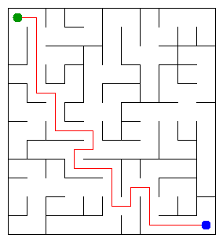

# Assignment 3. Maze Escape

Student ID: 254188
Name: Nurassyl Ilyas
Group: 254188
Maze size (rows x columns): 12 x 11

This file is the report. Fill it in as you go. How to start: `START_HERE.md`. The task: `docs/Assignment3.pdf`.

## Program output

The 13 lines my program prints on my data (`java -cp out Main`):

    Broken: 131
    Kept: 110
    Last broken wall: 193
    MST cost: 42957
    Heaviest broken wall: 832
    Path length: 25
    DFS visited: 100
    Dead ends: 40
    Zones: 9
    Largest zone: 24
    Is DAG: 0
    Flow stages: 7
    Fastest route cost: 10

`java tools/Check.java`: all checks of `DisjointSetTest` pass and all 13 lines are right on `tiny`, `small` and `dag`.

My maze:

## Questions

Mission 0. What do find and union do, and what makes them fast in your code?

`find(x)` walks from x up the parent links to the root, and the root is the name of the set. `union(a, b)` finds both roots; if they are the same it returns false, otherwise it hangs the root of the smaller tree under the root of the larger one and returns true. Two tricks make it fast: union by size keeps the trees no deeper than log n, and path compression in `find` hangs every cell on the walked path directly under the root, so the next `find` is almost one step. Together one operation costs amortized O(α(n)), which is at most 4 or 5 for any real n. Both `find` and `union` are loops, not recursion, so a chain of 1 000 000 cells (tested in `DisjointSetTest`) does not overflow the stack.

Mission 1. Why is Broken always R*C - 1, and Kept always (R-1)*(C-1)?

At the start every cell is its own set, so there are R*C sets, and each broken wall is a successful union that makes the number of sets one smaller. At the end there is exactly one set: the full grid is connected, so if two sets were left, some wall between them would have been looked at and broken. To go from R*C sets to 1 set we need exactly R*C - 1 unions, so Broken = R*C - 1 (for me 12*11 - 1 = 131). The grid has R*(C-1) vertical walls and C*(R-1) horizontal walls, together 2RC - R - C; Kept = 2RC - R - C - (RC - 1) = RC - R - C + 1 = (R-1)*(C-1) (for me 11*10 = 110).

Mission 2. My MST cost from Kruskal and from Prim, and why they are equal:

Kruskal gives 42957 and Prim gives 42957 (the heaviest broken wall is 832). Both are greedy algorithms that only take a wall that is the cheapest wall crossing some cut between two groups of cells, and by the cut property such a wall is always in a minimum spanning tree. All the costs are different, so the minimum spanning tree is unique: both algorithms must break exactly the same set of walls, only in a different order, so the total is the same.

Mission 3. Why is there exactly one path between two cells? How did you avoid a stack overflow on a huge maze?

The maze of Mission 1 is a spanning tree: it connects all cells and a wall is broken only when its two cells are in different sets, so a broken wall never closes a cycle. In a tree there is exactly one simple path between two cells: if there were two different paths, together they would form a cycle. That is why the DFS path is also the shortest way out (Path length 25). Instead of recursion I keep my own stack in an `int` array (the current way from the start) and an array `dir[cell]` with the next direction to try (up, right, down, left), which is what a recursive call would keep in its local variables. The memory is on the heap, so a 1000 x 1000 maze works (I tested it: path of 5412 moves, no `StackOverflowError`).

Mission 4. Why does the second pass of Kosaraju go on the reversed graph? Why do the slides have no cycle exactly when Zones equals the number of cells?

The cell that finishes last in the first pass is in a "source" zone: no slide comes into that zone from another zone. In the reversed graph a DFS from a cell reaches exactly the cells that can reach it by slides, and for a source zone these are only the cells of the same zone, so the second DFS collects exactly one zone and does not leak into others. On the original graph the DFS would go down the slides into every zone after it and glue many zones together. Already found zones are skipped, so the next cell in the list is again in a source zone of what is left; that is also why the numbers give a topological order. If there is a cycle, all its cells (at least two, there are no slides from a cell to itself) are in one zone, so Zones < n; if Zones < n, some zone has two cells u and v that reach each other, which is a cycle. So no cycle exactly when every zone has one cell, Zones = n.

Mission 5. Why is it enough to go through the zones in the order of their numbers? What does this pass cost?

Kosaraju numbers the zones in topological order: every edge X to Y of the zone graph has X < Y. So when I reach zone X, every zone that has an edge into X has a smaller number and was already processed, so the cheapest time to X and the longest chain ending in X are already final, and I can relax all edges out of X once. That is why no priority queue is needed (and it would also work with negative times, unlike Dijkstra). Slides inside one zone are skipped because walking inside a zone is free, and relaxing all slides X to Y automatically uses the cheapest one. The pass looks at every zone and every slide once: O(Z + S), which is O(n + m) together with building the zone graph.

## AI use

I used Claude (Anthropic, through Claude Code). It wrote the code of the missions (`DisjointSet`, `Maze`, `Escape`, `Zones`, the extra checks in `DisjointSetTest`) and a first draft of the answers in this README. I read every line, ran `java tools/Check.java`, `java -cp out Main` and `java -cp out Bench` myself and checked the answers against the lecture material. No code or text was taken from a book or a website.

## Timing (Mission 7)

Milliseconds, 5 runs each, from `java -cp out Bench`.

| maze | Kruskal | Prim |
|---|---|---|
| 100 x 100 | 18 11 8 7 7, avg 10 | 29 8 7 7 8, avg 12 |
| 300 x 300 | 34 20 20 20 26, avg 24 | 86 69 66 89 85, avg 79 |
| 1000 x 1000 | 346 369 391 308 391, avg 361 | 1927 1921 1857 1723 2095, avg 1905 |

What do the numbers say about how the time grows? Two or three sentences.

From 300 x 300 to 1000 x 1000 the number of cells grows about 11 times, Kruskal gets about 15 times slower and Prim about 24 times slower: a bit more than linear, as expected for O(m log m), plus the effect of the CPU cache on large arrays. Kruskal is faster because it sorts one primitive `long` array, while my Prim puts up to two boxed `Long` objects per wall into a `PriorityQueue`, which costs memory and garbage collection. On 100 x 100 the first run is slower than the others because the JIT has not compiled the code yet, so these small numbers are mostly noise.

## Complexity

n is the number of cells, m the number of walls (or slides). Fill in every algorithm you wrote.

| algorithm | time | space | assumptions |
|---|---|---|---|
| DSU find and union | O(α(n)) amortized per operation | O(n) | union by size and path compression; α is the inverse Ackermann function, at most 4–5 in practice |
| Kruskal | O(m log m) | O(n + m) | sorting the walls dominates; then m unions, O(m α(n)); in a grid m ≈ 2n |
| Prim | O(m log m) | O(n + m) | lazy Prim with a binary heap (`PriorityQueue`), each wall enters the queue at most twice |
| DFS | O(n + m) | O(n) | own stack in an array, each cell is entered once and each door is looked at from both sides; in the maze m = n − 1 |
| Kosaraju | O(n + m) | O(n + m) | two iterative DFS passes, adjacency lists (`slidesFrom` and `slidesInto`) |
| Route in the zone graph | O(n + m) | O(n + m) | zones already in topological order; one pass over all zones and slides, no priority queue |
